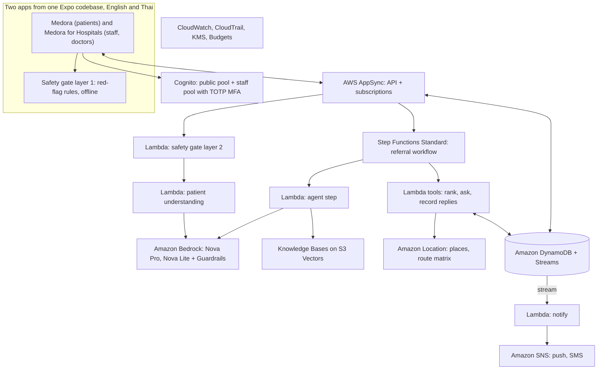
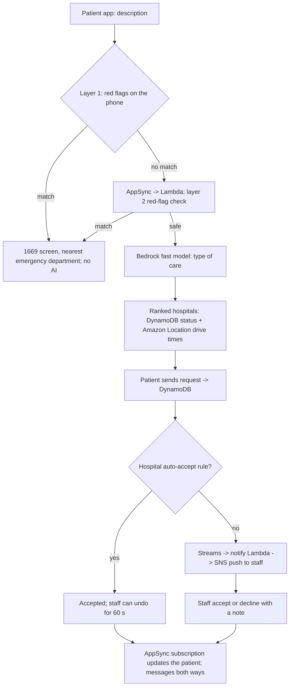
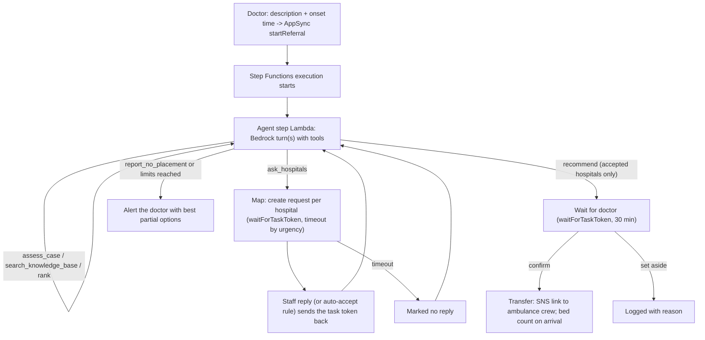

# Medora: final AWS architecture

The architecture for the hackathon build, in **us-east-1** (organizer sandbox), using Amazon's own models, serving the problem and solution in `docs/problem-and-solution.md`: fully serverless, every service justified by a judging criterion, inside the $350 AWS cap. Diagrams use Mermaid and render on GitHub. The backend code lives in `backend/amplify/`.

## 1. Services

| Layer | AWS service | Role in Medora |
| --- | --- | --- |
| Sign-in | Amazon Cognito: **public pool** and **staff pool** | Patients sign up themselves; hospital accounts by invitation only, with groups `hospital_staff`, `doctors`, `admins` and required TOTP multi-factor authentication |
| API and live updates | AWS AppSync | One API with both pools as sign-in providers; real-time subscriptions; public and operational data separated by rules |
| Compute | AWS Lambda (Node.js, TypeScript, Arm) | Safety gate, patient understanding, agent steps, tools, notifications |
| Data | Amazon DynamoDB (on-demand) + Streams | Hospital status, requests, messages, referrals, agent state, traces, activity |
| Orchestration | AWS Step Functions (**Standard**) | Referral workflow: agent turns, parallel hospital requests, waiting for replies and the doctor's confirmation (callback pattern with task tokens) |
| AI | Amazon Bedrock: Amazon Nova Pro and Nova Lite, Converse API with tool use | Nova Lite: patient understanding; Nova Pro: referral coordinator agent |
| AI safety | Amazon Bedrock Guardrails | Blocks diagnosis and treatment advice; masks personal data |
| Retrieval (RAG) | Bedrock Knowledge Bases + Amazon Titan Text Embeddings V2 + Amazon S3 + Amazon S3 Vectors | One document per hospital department; no chunking |
| Maps and routing | Amazon Location Service (Places and Routes v2, no resources of their own) | Place search for the location picker (`search-places` Lambda); route matrix drive times for the referral agent, with the offline estimate as the fallback |
| Notifications | Amazon SNS | Push to phones (FCM, APNs); SMS link to the ambulance crew |
| Schedules | Amazon EventBridge Scheduler | 30-minute status check-in reminders |
| Security | AWS KMS, IAM, AWS CloudTrail, CloudWatch Logs data protection | Encryption at rest, least privilege, audit, log redaction |
| Monitoring | Amazon CloudWatch, AWS X-Ray (sampled) | Logs (7 days), alarms, traces |
| Cost | AWS Budgets, Cost Anomaly Detection, Cost Explorer | Team alarms below $350; evidence of cost efficiency |
| Delivery | AWS Amplify Gen 2 (CDK), GitHub Actions | Backend as code per stage; guardrails on every pull request |

Not used, on purpose: EC2, RDS or Aurora, ECS or Fargate, SageMaker or GPUs, OpenSearch Serverless, NAT gateways, VPCs, load balancers, Multi-AZ, API Gateway (AppSync covers it), QuickSight (after the competition).

## 2. Overall architecture

## 3. Patient flow

## 4. Referral flow (Step Functions Standard)

The agent's conversation is saved in DynamoDB between steps, so Step Functions can pause for hospitals and the doctor without a Lambda waiting.

Limits: at most 8 model turns, 2 rounds of asking, and 10 minutes for the agent part of the execution. If Bedrock fails or a limit is reached, the same state machine runs the rule-based backup path and labels the trace.

## 5. Agent decision workflow

| Step | Done by | Notes |
| --- | --- | --- |
| Pathway and time budget | Nova Pro (`assess_case`) | Window left = pathway window minus minutes since onset |
| Retrieve evidence | Nova Pro (`search_knowledge_base`) | Sources shown in the trace |
| Filter and rank | Fixed tool | Departments, equipment, doctors on duty, beds, reachable in time; score |
| Ask and wait | Step Functions | Parallel requests; auto-accept rules; timeouts |
| Judge replies | Nova Pro | Weighs staff notes and delays against the window |
| Re-plan | Nova Pro | Next best hospitals, at most 2 rounds |
| Recommend | Nova Pro (`recommend`) | Accepted hospitals only; others withdrawn; reasons in English and Thai |
| Confirm | Doctor | Required before any transfer |

## 6. Security

| Control | Implementation |
| --- | --- |
| Cognito | Public pool for patients; invite-only staff pool for hospitals; 1-hour access tokens |
| MFA for staff | TOTP (authenticator app) required by the staff pool; no SMS codes |
| Encryption at rest | AWS-managed KMS keys for DynamoDB, S3, SNS, CloudWatch Logs, Step Functions |
| Encryption in transit | TLS everywhere; S3 bucket policies deny non-TLS requests |
| Least-privilege IAM | One role per Lambda; Bedrock limited to the two model or inference profile ARNs and the knowledge base ARN; no `*` resources for Bedrock |
| Data access | AppSync owner and group rules: patients see their own requests; staff their hospital |
| Audit | CloudTrail event history (90 days) + the Activity table for every app decision |
| Log redaction | CloudWatch Logs data protection policy on Lambda log groups; Lambdas log IDs and statuses, never descriptions, notes or messages; Bedrock model invocation logging off |
| AI safety | Bedrock Guardrails on every model call; prompts keep user text in delimited data blocks |
| Public exposure | S3 Block Public Access; AWS WAF rate limit on AppSync in demo week only |

## 7. Cost at hackathon scale

| Service | Expected |
| --- | --- |
| Bedrock: Nova Pro, Nova Lite, Titan embeddings | Most of the spend, but Nova costs far less per call than larger third-party models |
| Step Functions Standard | Fractions of a cent per referral (a few dozen state transitions) |
| Lambda, AppSync, DynamoDB, Cognito, SNS push, EventBridge | Within free tiers or a few dollars |
| Amazon Location, CloudWatch, S3 Vectors | A few dollars |
| WAF (demo week only) | About $6 to $8 |

Guardrails: budget alarms at $100, $200, $280, $320 actual and $350 forecast; daily `scripts/cost-check.sh`; `scripts/guard.sh` on every pull request.
